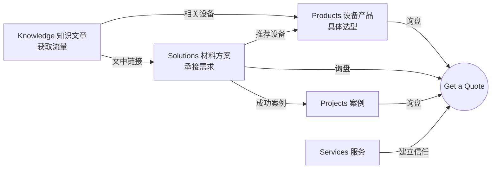
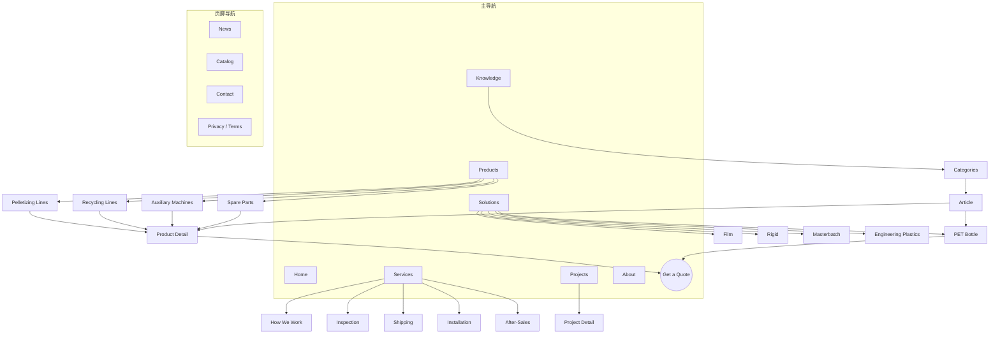
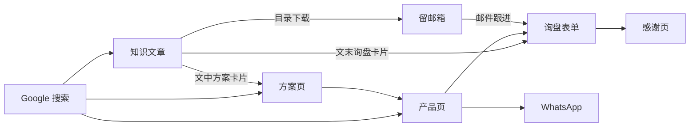

# Extruder China 网站架构与方向 v1.0

站点：https://www.extruderchina.com/
配套：`Visual-Guidelines.md`（视觉规范）、`tokens.css`（设计变量）

---

# 01 定位与目标

## 一句话定位

**帮海外工厂从中国买到合适、可靠的塑料造粒与回收设备的采购与项目伙伴。**

英文表述：*Your sourcing and project partner for plastic pelletizing and recycling machinery from China.*

## 商业模式与对外口径

Extruder China 不自己生产设备，而是从经过审核的中国工厂网络中为客户选型、采购、验货、发运并协调安装售后。网站**公开说明这一模式**，把它作为优势来讲：

| 买家的顾虑 | 网站给出的回答 |
| --- | --- |
| 直接找工厂不是更便宜吗？ | 我们按项目匹配最合适的工厂，并承担选型错误、质量和沟通风险 |
| 贸易商靠得住吗？ | 工厂审核标准、出货前验机（视频 + 报告）、合同与售后由我们负责 |
| 出了问题找谁？ | 一个联系人负责到底：备件、远程支持、现场工程师协调 |

### 用词规则

- 用 **supplier / sourcing partner / project partner**，不要自称 **manufacturer / factory**，避免虚假宣传和后续信任危机。
- 可以写 "factory-direct pricing"、"audited factory network"、"pre-shipment inspection"。
- 合作工厂名称是否公开，由商务决定；网站上默认只展示工厂实拍、认证和验机过程，不展示名称。

## 目标用户

| 用户 | 特征 | 在网站上想做什么 |
| --- | --- | --- |
| 回收工厂老板 / 投资人 | 新建或扩建回收线，预算敏感，看重回本周期 | 找整线方案、看产能和价格区间、比较供应商 |
| 改性 / 色母粒工厂技术负责人 | 懂工艺，看参数 | 查螺杆配置、产量、切粒方式，读技术文章 |
| 采购经理 | 负责比价、走流程 | 下载目录、要报价、确认交期和付款条件 |
| 设备维修人员 | 已有设备，需要备件 | 找螺杆机筒、换网器、刀片等备件 |

主要市场（建议优先）：东南亚、南亚、中东、非洲、拉美、东欧。这些地区回收和造粒需求增长快、对中国设备接受度高。英文先行，后续加西班牙语、俄语、阿拉伯语、葡萄牙语。

## 网站目标与衡量指标

| 目标 | 指标 | 上线 6 个月参考值 |
| --- | --- | --- |
| 获取询盘（第一目标） | 有效询盘数、询盘转化率 | 转化率 1.5–3% |
| SEO 自然流量 | Google 自然点击、排名关键词数 | 月自然点击 5,000+ |
| 建立信任 | 服务页、案例页浏览率；平均停留时长 | 询盘用户中 50% 以上看过服务或案例页 |

---

# 02 整体策略：三层结构 + 一套共享主题

买家搜索设备有两种方式：

- 按**设备类型**搜：twin screw extruder、plastic shredder、screw and barrel
- 按**材料和用途**搜：PET bottle washing line、PP PE film recycling machine、masterbatch production line

所以网站分三层，并共用同一套"材料/用途"主题标签，互相串联：



| 层 | 作用 | 搜索意图 | 例子 |
| --- | --- | --- | --- |
| Knowledge | 吸引流量、教育用户 | 信息型 | How to start a PET bottle recycling plant |
| Solutions | 按材料给出整线方案 | 商业调研型 | PET Bottle Recycling Line |
| Products | 具体设备与参数 | 交易型 | 1000 kg/h PET Bottle Washing Line |

## 共享主题标签（Material / Application）

所有产品、方案、文章、案例、新闻都打上同一套标签，用于自动生成"相关内容"和内链：

| 标签 | 对应方案页 |
| --- | --- |
| PET Bottles | PET Bottle Recycling |
| PP & PE Film | Film Recycling & Pelletizing |
| Rigid Plastics (HDPE / PP) | Rigid Plastic Recycling |
| PP Woven & Raffia | （并入 Film Recycling） |
| Masterbatch & Filler | Masterbatch & Filler Compounding |
| Engineering Plastics | Engineering Plastic Compounding |

---

# 03 页面层级

```
Homepage (/)
├── Products (/products/)
│   ├── Pelletizing & Compounding Lines (/products/pelletizing-lines/)
│   │   ├── Single Screw Pelletizing Line
│   │   ├── Two-Stage Pelletizing Line (for film)
│   │   ├── Twin Screw Compounding Extruder
│   │   ├── Water Ring Pelletizer
│   │   ├── Strand Pelletizing Line
│   │   └── Underwater Pelletizer
│   ├── Plastic Recycling Lines (/products/recycling-lines/)
│   │   ├── PET Bottle Washing Line
│   │   ├── PP PE Film Washing Line
│   │   ├── Rigid Plastic Washing Line
│   │   └── Plastic Film Squeezer / Dryer
│   ├── Auxiliary Machines (/products/auxiliary-machines/)
│   │   ├── Shredders · Crushers · Mixers · Dryers · Chillers · Loaders
│   └── Spare Parts (/products/spare-parts/)
│       ├── Screws & Barrels · Screen Changers · Die Heads
│       └── Pelletizer Blades · Crusher Blades · Gearboxes
│       （产品详情：/products/{category}/{product}/）
├── Solutions (/solutions/)
│   ├── PET Bottle Recycling (/solutions/pet-bottle-recycling/)
│   ├── Film Recycling & Pelletizing (/solutions/film-recycling/)
│   ├── Rigid Plastic Recycling (/solutions/rigid-plastic-recycling/)
│   ├── Masterbatch & Filler Compounding (/solutions/masterbatch-compounding/)
│   └── Engineering Plastic Compounding (/solutions/engineering-plastic-compounding/)
├── Services (/services/)
│   ├── How We Work 采购流程 (/services/how-we-work/)
│   ├── Factory Audit & Inspection 工厂审核与验机 (/services/inspection/)
│   ├── Shipping & Export 发运与出口文件 (/services/shipping/)
│   ├── Installation & Training 安装与培训 (/services/installation/)
│   └── After-Sales & Spare Parts 售后与备件 (/services/after-sales/)
├── Projects (/projects/)
│   └── Project detail (/projects/{slug}/)
├── Knowledge (/knowledge/)
│   ├── Category: Buying Guides (/knowledge/category/buying-guides/)
│   ├── Category: Recycling (/knowledge/category/recycling/)
│   ├── Category: Pelletizing & Compounding (/knowledge/category/pelletizing/)
│   ├── Category: Maintenance & Troubleshooting (/knowledge/category/maintenance/)
│   ├── Category: Materials (/knowledge/category/materials/)
│   ├── Category: Cost & ROI (/knowledge/category/cost/)
│   └── Article (/knowledge/{slug}/)
├── News (/news/)
│   └── News article (/news/{slug}/)
├── About (/about/)
│   └── Our Team (/about/team/) · Author pages (/author/{name}/)
├── Contact (/contact/)
├── Get a Quote (/get-a-quote/)
├── Catalog Download (/catalog/)
├── Thank You (/thank-you/)          ← noindex，仅用于转化统计
├── Privacy Policy (/privacy-policy/) · Terms (/terms/)
└── HTML Sitemap (/sitemap/)
```

最深层级为 3 级（如产品详情），任何重要页面从首页 3 次点击内可达。

## 可视化站点图



---

# 04 URL 规则与关键页面

## 规则

1. 全部小写，用连字符 `-`，统一**带结尾斜杠**（WordPress 默认），不带斜杠的自动 301 跳转。
2. 不在 URL 中放日期、ID、中文。
3. 文章 URL 不带分类：`/knowledge/{slug}/`。这样文章改分类时 URL 不变。
4. slug 包含主关键词，3–6 个单词，例：`/knowledge/pet-bottle-washing-process/`。
5. 产品 URL 带分类：`/products/recycling-lines/pet-bottle-washing-line/`，层级清楚，面包屑一致。
6. 不加产能数字到产品 URL（产能会变）；具体型号放在页面参数表中。
7. 预留多语言目录：`/es/`、`/ru/`、`/ar/`、`/pt/`。

## 关键页面 URL 表

| 页面 | URL | 上级 | 导航位置 | 优先级 |
| --- | --- | --- | --- | --- |
| 首页 | `/` | — | Logo | 最高 |
| 产品总览 | `/products/` | 首页 | 主导航 | 高 |
| 造粒与改性线 | `/products/pelletizing-lines/` | 产品 | 主导航下拉 | 高 |
| 回收清洗线 | `/products/recycling-lines/` | 产品 | 主导航下拉 | 高 |
| 辅机 | `/products/auxiliary-machines/` | 产品 | 主导航下拉 | 中 |
| 备件 | `/products/spare-parts/` | 产品 | 主导航下拉 | 中 |
| 方案总览 | `/solutions/` | 首页 | 主导航 | 高 |
| PET 瓶回收方案 | `/solutions/pet-bottle-recycling/` | 方案 | 主导航下拉 | 高 |
| 服务总览 | `/services/` | 首页 | 主导航 | 高 |
| 采购流程 | `/services/how-we-work/` | 服务 | 主导航下拉 | 高 |
| 案例 | `/projects/` | 首页 | 主导航 | 中 |
| 知识中心 | `/knowledge/` | 首页 | 主导航 | 高 |
| 新闻 | `/news/` | 首页 | 知识下拉 + 页脚 | 中 |
| 关于我们 | `/about/` | 首页 | 主导航 | 中 |
| 获取报价 | `/get-a-quote/` | 首页 | 导航右侧按钮 | 最高 |
| 联系我们 | `/contact/` | 首页 | 关于下拉 + 页脚 | 中 |
| 目录下载 | `/catalog/` | 首页 | 页脚 + 文章内 | 中 |
| 感谢页 | `/thank-you/` | — | 不展示（noindex） | — |

---

# 05 导航

## 主导航（桌面端）

```
[Logo]  Products ▾  Solutions ▾  Services ▾  Projects  Knowledge ▾  About ▾     [EN ▾] [Get a Quote]
```

### Products 大下拉菜单（4 列）

| Pelletizing & Compounding | Recycling Lines | Auxiliary Machines | Spare Parts |
| --- | --- | --- | --- |
| Single Screw Pelletizing | PET Bottle Washing | Shredders | Screws & Barrels |
| Two-Stage Pelletizing | PP PE Film Washing | Crushers | Screen Changers |
| Twin Screw Compounding | Rigid Plastic Washing | Mixers | Die Heads |
| Water Ring Pelletizer | Film Squeezer / Dryer | Dryers · Chillers | Blades |
| Strand / Underwater | | Loaders | Gearboxes |

菜单底部一条横幅："Not sure which line you need? → Talk to an engineer"（链接到询盘页）。

### Solutions 下拉

5 个材料方案，每项带一句说明，如 "PET Bottle Recycling — bottle-to-flake and bottle-to-pellet lines"。

### Services 下拉

How We Work · Factory Audit & Inspection · Shipping & Export · Installation & Training · After-Sales & Spare Parts

### Knowledge 下拉

Buying Guides · Recycling · Pelletizing & Compounding · Maintenance · Materials · Cost & ROI · **News**

### About 下拉

About Us · Our Team · Contact

## 移动端

- 顶栏：图形 logo + "Get a Quote" 小按钮 + 汉堡菜单。
- 菜单内一级项可展开，最下方放 WhatsApp 与邮箱。
- 右下角固定 WhatsApp 按钮。

## 页脚

| Products | Solutions | Resources | Company | Contact |
| --- | --- | --- | --- | --- |
| Pelletizing Lines | PET Bottle Recycling | Knowledge | About Us | 邮箱 |
| Recycling Lines | Film Recycling | News | How We Work | WhatsApp |
| Auxiliary Machines | Rigid Plastic Recycling | Catalog Download | Projects | 地址 |
| Spare Parts | Masterbatch | Buying Guides | Contact | Get a Quote 按钮 |

底部：© 版权 · Privacy Policy · Terms · Sitemap

## 面包屑

所有页面（首页除外）显示，与 URL 层级一致：

- `Home / Products / Recycling Lines / PET Bottle Washing Line`
- `Home / Knowledge / Recycling / How to Start a PET Bottle Recycling Plant`（显示主分类，URL 不含分类）
- `Home / News / {标题}`

---

# 06 页面模板

每个模板列出模块顺序（从上到下）。

## 首页

1. 首屏（深色）：一句定位 + 说明 + Get a Quote / View Solutions；右侧设备实拍或线条图形
2. 信任条：出口国家数、交付项目数、合作工厂数、认证（CE / ISO）
3. 按材料找方案：5 张方案卡片
4. 产品分类：4 个分类入口
5. 为什么通过我们采购：4 点（选型、审核验机、一站式发运、售后负责）+ 链接 How We Work
6. 采购流程：6 步时间线（需求 → 方案报价 → 工厂匹配 → 生产与验机 → 发运 → 安装售后）
7. 精选案例：3 个
8. 最新知识文章：3 篇
9. CTA 横幅（深色）+ 询盘表单
10. 页脚

## 产品分类页

1. 面包屑 + H1 + 一段说明（含关键词）
2. 按材料筛选（标签）
3. 产品卡片网格
4. 选型指南摘要 + 链接到 Buying Guide 文章
5. FAQ（4–6 条）
6. CTA

## 产品详情页（核心转化页）

1. 面包屑
2. 首屏：左侧图片/视频画廊，右侧 H1、一句话卖点、关键参数标签、主按钮 Get a Quote（自动带上产品名）+ WhatsApp
3. 适用材料与最终产品（例：PET bottles → hot-washed flakes）
4. 工艺流程图（整线类产品）
5. 技术参数表（多型号）
6. 配置与可选项
7. 验机视频 / 车间实拍
8. 相关案例
9. 相关知识文章（同主题标签自动调取 3 篇）
10. FAQ
11. 询盘表单（产品字段已预填）

## 方案页（Solutions）

1. 首屏：材料 + 最终产品 + 典型产能范围
2. 痛点与目标（买家这个材料常遇到的问题）
3. 推荐工艺路线（可有 2–3 条：如 bottle-to-flake / bottle-to-pellet）
4. 每条路线的设备组合（链接到产品页）
5. 产能与投资区间说明（不写具体价格，写影响价格的因素）
6. 案例
7. 指南文章（链接到该主题的支柱文章 + 3–5 篇）
8. FAQ + 询盘表单

## 服务页

1. 首屏：服务承诺一句话
2. 具体做法（步骤 / 清单）
3. 证据：验机报告样例、发运照片、视频
4. 买家常见顾虑 FAQ
5. CTA

## 案例详情页

客户国家与行业 → 需求 → 方案（设备清单）→ 交付过程（验机、发运、安装）→ 结果（产能、投产时间）→ 客户评价 → 相关产品 → CTA

## 知识中心首页

1. H1 + 搜索框
2. 分类导航
3. 支柱指南（5 篇大文章）
4. 最新文章列表（分页，每页 12 篇）
5. 订阅 / 目录下载

## 知识文章页

按视觉规范 "文章详情页" 执行：

1. 面包屑 → 分类标签 → H1 → 作者（真实人员，带头像和简介）· 更新日期 · 阅读时长
2. 要点摘要（Key Takeaways，3–5 条）
3. 吸顶目录 + 正文
4. 正文中段：与文章主题匹配的方案卡片（自动按主题标签调取）
5. 文末：询盘卡片 → 相关产品 → 相关文章 → FAQ
6. 作者简介

## 新闻页

H1 → 日期 · 来源 → 正文（必须包含 "What this means for buyers" 小节）→ 相关知识文章 → 询盘卡片

## 获取报价页

左侧：表单（姓名、邮箱、公司、国家、WhatsApp 选填、感兴趣的设备 / 材料、产能需求、留言、附件上传）；右侧：响应承诺（24 小时内回复）、流程 3 步、联系方式、信任标识。

---

# 07 内容策略

## 内容类型与比例

| 类型 | 位置 | 占比 | 目的 |
| --- | --- | --- | --- |
| 支柱指南（3,000–5,000 词） | Knowledge | 每个方案主题 1 篇 | 拿核心词排名，汇聚内链 |
| 选购指南、对比文章 | Knowledge | 30% | 承接商业调研流量，转化率最高 |
| 工艺与技术文章 | Knowledge | 30% | 覆盖长尾词，建立专业度 |
| 维护与故障排除 | Knowledge | 15% | 吸引已有设备用户，带动备件询盘 |
| 成本与回报 | Knowledge | 10% | 投资人关心，高转化 |
| 行业新闻 | News | 15% | 时效流量、社媒分发、站点活跃度 |

## 主题集群（每个方案一组）

以 PET 瓶回收为例：

```
支柱：PET Bottle Recycling: The Complete Guide   (/knowledge/pet-bottle-recycling-guide/)
├── How to Start a PET Bottle Recycling Plant
├── PET Bottle Washing Line: Process Step by Step
├── Hot Washing vs Cold Washing for PET Flakes
├── PET Bottle Recycling Machine Price: What Affects the Cost
├── How to Reduce PVC Contamination in PET Flakes
├── PET Flake Quality Standards for Bottle-to-Bottle
└── Troubleshooting PET Flake Moisture Problems
→ 全部链接到：/solutions/pet-bottle-recycling/ 和相关产品页
```

其余 4 个集群同理：Film Recycling、Rigid Plastic、Masterbatch & Filler、Engineering Plastics。另有 2 个横向集群：Twin Screw Extruders（技术）、Spare Parts & Maintenance（备件）。

## 关键词方向（示例，需用工具验证搜索量）

| 主题 | 核心词 | 长尾举例 |
| --- | --- | --- |
| 造粒 | plastic pelletizing machine, plastic granulator machine | water ring vs strand pelletizer, two stage pelletizing line for film |
| 改性 | twin screw extruder, compounding extruder | twin screw extruder for masterbatch, glass fiber PA compounding |
| PET 回收 | PET bottle washing line, PET recycling machine | PET bottle recycling plant cost, hot washing PET flakes |
| 薄膜回收 | plastic film washing line, film recycling machine | PP woven bag recycling line, agricultural film recycling |
| 硬料回收 | HDPE recycling machine, rigid plastic washing line | HDPE drum recycling, PP crate crushing and washing |
| 辅机 | plastic shredder, plastic crusher, centrifugal dryer | single shaft vs double shaft shredder |
| 备件 | extruder screw and barrel, screen changer | bimetallic barrel vs nitrided barrel, pelletizer blade replacement |
| 采购 | plastic machinery supplier China | how to import plastic machines from China, inspection before shipment |

## 发布节奏

| 内容 | 频率 |
| --- | --- |
| 知识文章 | 每天 1–2 篇（上线前先储备 20–30 篇） |
| 新闻 | 每天最多 1 篇，必须有原创解读 |
| 老文章更新 | 每月更新排名 5–20 位的文章 10 篇 |
| 支柱指南 | 每季度全面复查一次 |

宁可每天 1 篇好文章，也不要每天 5 篇相似文章。

## AI 辅助写作的质量流程

Google 会处罚大量生产、缺少原创价值的内容（scaled content abuse）。每篇文章必须走完以下流程才能发布：

1. **选题**：从关键词表领取，确认没有与已有文章重复（避免内容互相抢排名）。
2. **写作简报**：主关键词、搜索意图、大纲、要链接的方案和产品页。
3. **AI 起草**：按简报生成初稿。
4. **专业审核**：懂设备的人核对参数、工艺、价格区间，删除错误和空话。
5. **加入原创内容**（至少 1 项）：工厂/验机实拍、项目真实数据、工程师观点、对比表格、计算示例。
6. **SEO 检查**：标题、描述、H2 结构、图片 alt、内链 3–8 个、FAQ。
7. **发布**：署真实作者名。

### 发布前检查清单

- [ ] 回答了搜索者的问题，开头 100 词内给出要点
- [ ] 没有与站内已有文章主题重复
- [ ] 参数和数据经过人工核对
- [ ] 至少 1 项原创内容（图片、数据、案例或观点）
- [ ] 链接到 1 个方案页 + 1–2 个产品页 + 2–3 篇相关文章
- [ ] 有真实作者署名和更新日期
- [ ] 封面图符合视觉规范（16:9，WebP，150KB 以内）

## 新闻规则

- 只选与买家决策相关的新闻：回收政策、原料价格、塑料禁令、展会、市场需求。
- 每篇必须有 "What this means for buyers" 小节，并链接到 1 篇知识文章或方案页。
- 不整段转载、不只做改写；注明原始来源链接。
- 每 6 个月复查：过时且无流量的新闻合并或设为 noindex。

---

# 08 内链规则

| 来源页 | 必须链接到 |
| --- | --- |
| 知识文章 | 对应方案页 1 个 + 相关产品 1–2 个 + 同集群文章 2–3 篇 + 支柱指南 |
| 支柱指南 | 本集群全部文章 + 方案页 + 主要产品 |
| 方案页 | 推荐设备产品页 + 支柱指南 + 3–5 篇文章 + 案例 |
| 产品页 | 所属方案页 + 3 篇相关文章 + 相关案例 + 相关备件/辅机 |
| 案例页 | 使用的产品 + 对应方案页 |
| 新闻 | 1 篇知识文章或方案页 |

其他规则：

- 锚文本写清楚内容，如 "PET bottle washing line"，不要写 "click here"。
- 每篇文章发布时，同时回到 1–2 篇老文章中加上指向新文章的链接，避免出现孤立页面。
- "相关内容"模块按共享主题标签自动调取，减少人工维护。
- 首页、方案页、核心产品页获得最多内链。

---

# 09 转化路径与数据追踪

## 主要转化路径



## 转化入口

| 入口 | 位置 | 说明 |
| --- | --- | --- |
| 询盘表单 | 获取报价页、产品页底部、方案页底部 | 主要转化 |
| 文章内询盘卡片 | 文章中段 + 文末 | 按文章主题显示对应方案 |
| WhatsApp 按钮 | 全站右下角、产品页首屏 | 新兴市场买家最常用 |
| 目录下载 | 文章内、页脚 | 用邮箱换 PDF 目录，进入邮件跟进 |
| 邮箱 / 电话点击 | 页脚、联系页 | 次要 |

## 表单隐藏字段

每个表单自动记录：来源页面 URL、产品名（产品页）、主题标签、UTM 参数、首次访问来源。便于判断哪些文章带来询盘。

## GA4 事件

| 事件 | 触发 | 是否设为关键事件 |
| --- | --- | --- |
| `generate_lead` | 询盘提交成功（感谢页） | 是 |
| `catalog_download` | 目录下载提交 | 是 |
| `whatsapp_click` | 点击 WhatsApp | 是 |
| `email_click` / `phone_click` | 点击邮箱 / 电话 | 否 |
| `quote_cta_click` | 点击任意 Get a Quote 按钮 | 否 |
| `scroll_75` | 文章滚动到 75% | 否 |

同时接入 Google Search Console，并提交 XML 站点地图。

---

# 10 WordPress 实现方案

## 内容类型

| 内容 | WordPress 实现 | URL |
| --- | --- | --- |
| 知识文章 | 默认文章（Posts） | `/knowledge/{slug}/` |
| 新闻 | 自定义文章类型 `news` | `/news/{slug}/` |
| 产品 | 自定义文章类型 `product` + 分类法 `product_cat` | `/products/{cat}/{slug}/` |
| 方案 | 页面（Pages），父页面 Solutions | `/solutions/{slug}/` |
| 服务 | 页面，父页面 Services | `/services/{slug}/` |
| 案例 | 自定义文章类型 `project` | `/projects/{slug}/` |

共享分类法 `material`（材料/用途），同时挂在 Posts、news、product、project 上，用于自动调取相关内容。

产品参数用 ACF 自定义字段：型号表、产能、适用材料、电机功率、视频、画廊、FAQ。

## 技术选型建议

| 用途 | 建议 |
| --- | --- |
| 主题 | 轻量主题（GeneratePress 或 Kadence），按视觉规范写子主题样式 |
| 页面搭建 | 文章和产品用 Gutenberg 区块（便于 AI 流程通过 REST API 批量发布）；首页、方案页等营销页可用 Elementor |
| SEO | Rank Math：标题描述、XML 站点地图、面包屑、结构化数据 |
| 自定义字段 | ACF Pro |
| 表单 | Fluent Forms 或 Gravity Forms（支持隐藏字段、附件、Webhook 推送到 CRM / 飞书） |
| 缓存与速度 | LiteSpeed Cache 或 WP Rocket + Cloudflare |
| 图片 | 自动转 WebP（ShortPixel 或 Imagify） |
| 多语言（第三阶段） | TranslatePress 或 WPML，子目录 `/es/` 等 |

## 结构化数据（Schema）

| 页面 | 类型 |
| --- | --- |
| 全站 | Organization、WebSite、BreadcrumbList |
| 产品页 | Product（不填价格）、FAQPage |
| 知识文章 | Article + 作者 Person |
| 新闻 | NewsArticle |
| 视频 | VideoObject |
| 联系页 | ContactPage |

## 性能目标

Largest Contentful Paint（最大内容绘制）< 2.5 秒，Cumulative Layout Shift（布局偏移）< 0.1，移动端 PageSpeed 分数 80 以上。

---

# 11 分阶段上线

## 第一阶段：上线最小可用站点（约 4–6 周）

| 内容 | 数量 |
| --- | --- |
| 首页 | 1 |
| 产品分类页 | 4 |
| 产品详情页 | 12–20（每个分类 3–6 个主力产品） |
| 方案页 | 5 |
| 服务页 | Services 总览 + How We Work + Inspection（其余 3 页可先合并在总览中） |
| About、Contact、Get a Quote、Thank You、隐私政策、条款 | 6 |
| 知识文章 | 20–30 篇（5 篇支柱指南 + 每集群 3–5 篇） |
| 数据追踪 | GA4 事件、Search Console、表单隐藏字段 |

## 第二阶段：内容与信任加强（上线后第 2–3 个月）

- 案例板块（至少 3–5 个真实案例）
- 新闻板块开始更新
- 目录下载 + 邮件跟进流程
- 作者页、团队页
- 补齐服务页（Shipping、Installation、After-Sales）
- 对比类文章：如 "Buying from a Trading Company vs Direct from Factory"

## 第三阶段：规模化（第 4 个月起）

- 多语言：按 Search Console 中的国家流量决定顺序（建议西班牙语 → 俄语 → 阿拉伯语 → 葡萄牙语）
- 免费工具：回收线产能 / 投资回报计算器（获取外链与询盘）
- 按"材料 × 设备"批量生成落地页（需有真实差异化内容才做）
- 视频板块（验机、运行视频，同步 YouTube）

---

# 12 待补充信息

开始做页面前，需要准备：

1. **产品清单**：首批 12–20 个主力产品的名称、型号、参数、图片和视频。
2. **案例**：已交付项目的国家、设备、照片，以及客户是否同意公开。
3. **信任证据**：合作工厂的认证、验机报告样例、发运照片。
4. **团队信息**：真实的作者 / 工程师姓名、头像、简介（用于文章署名）。
5. **公司信息**：注册主体、地址、邮箱、WhatsApp、电话。
6. **询盘接收**：表单提交后推送到哪里（邮箱、CRM、飞书）。
